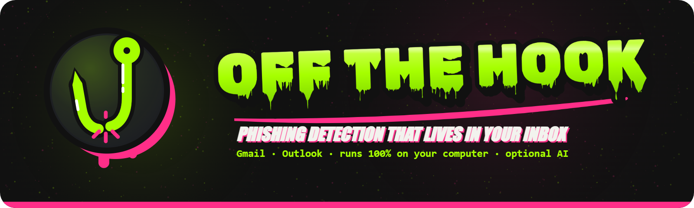
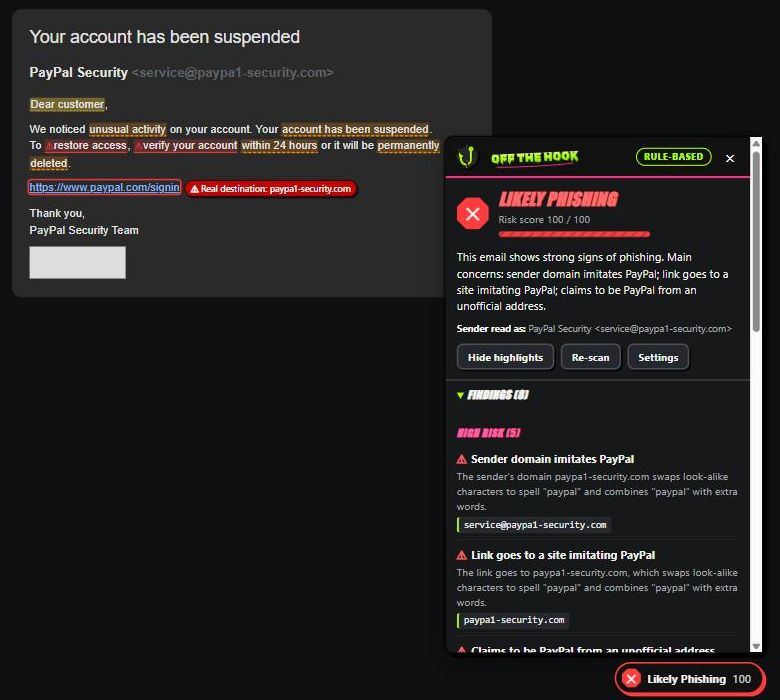
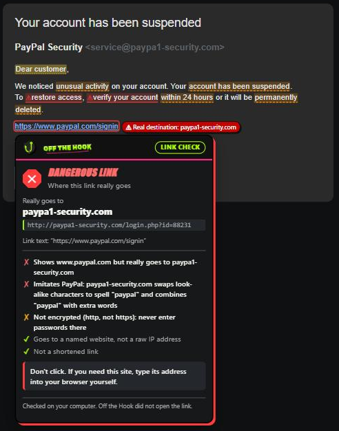
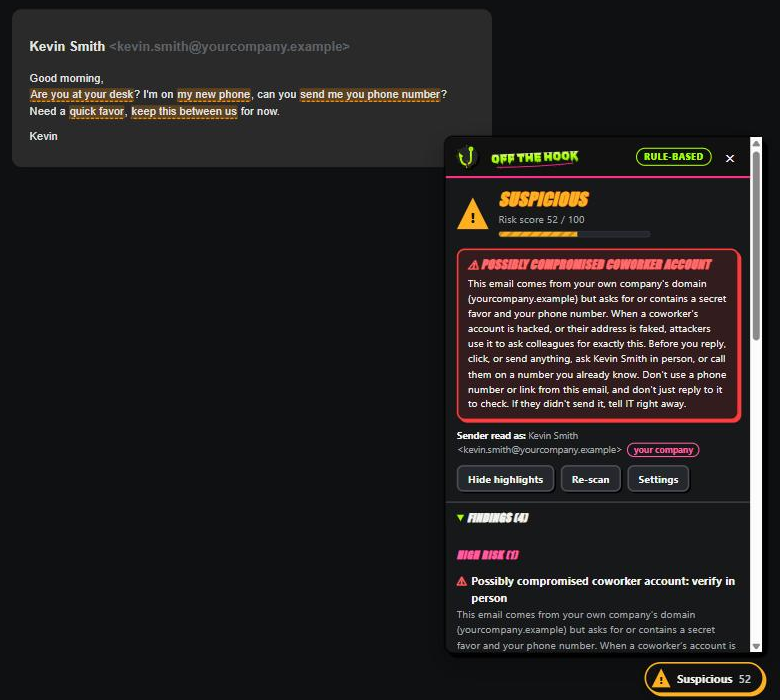
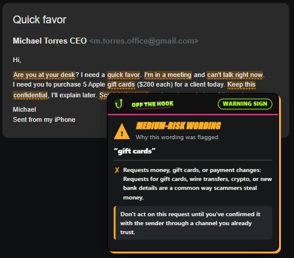
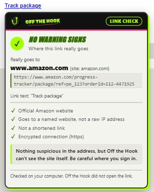
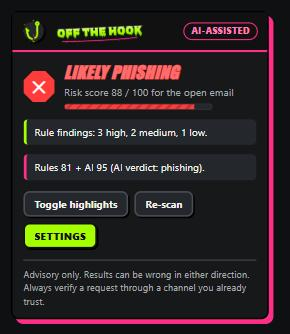
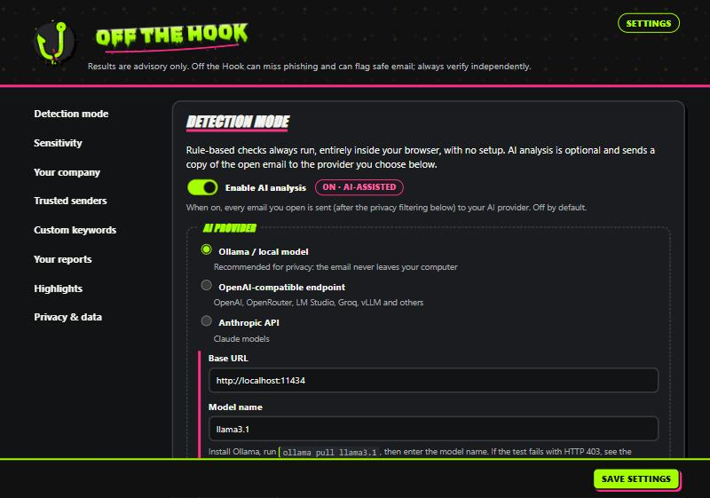
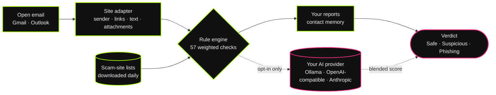

<p align="center">
  
</p>

<p align="center">
  
  
  
  
  
</p>

<p align="center">
  <b>Off the Hook</b> reads the email you have open in Gmail or Outlook,<br>
  highlights the phishing giveaways, and tells you <i>why</i>, without your email ever leaving your computer.
</p>

<p align="center">
  <a href="#install"><b>Install</b></a> &nbsp;·&nbsp;
  <a href="#features"><b>Features</b></a> &nbsp;·&nbsp;
  <a href="#how-it-works"><b>How it works</b></a> &nbsp;·&nbsp;
  <a href="#privacy"><b>Privacy</b></a> &nbsp;·&nbsp;
  <a href="#ai-mode-optional"><b>AI mode</b></a> &nbsp;·&nbsp;
  <a href="#learn"><b>Learn</b></a> &nbsp;·&nbsp;
  <a href="#development"><b>Develop</b></a>
</p>

<br>

<p align="center">
  
</p>

<br>

## Features

<table>
  <tr>
    <td width="33%" valign="top">
      <h3>🛡️ Your email stays put</h3>
      55+ built-in checks run in your browser. No account, no setup, and <b>your email is never sent anywhere</b>.
    </td>
    <td width="33%" valign="top">
      <h3>🔦 Shows its work</h3>
      Suspicious wording is highlighted in the email, and every warning explains why in plain English.
    </td>
    <td width="33%" valign="top">
      <h3>🔗 Hover-to-check links</h3>
      See where any link <i>really</i> goes, with Safe Links unwrapped and every check listed. It never opens the link.
    </td>
  </tr>
  <tr>
    <td valign="top">
      <h3>🏢 Knows your company</h3>
      Warns when a <b>coworker's account looks hacked</b> and tells you to check with them in person. Catches look-alike company domains.
    </td>
    <td valign="top">
      <h3>🧠 Learns from you</h3>
      <i>It's phishing</i> / <i>It's safe</i> buttons teach it senders, sites and wording instantly. Stored locally, exportable.
    </td>
    <td valign="top">
      <h3>🤖 Optional AI</h3>
      Add a second opinion from a local Ollama model, any OpenAI-compatible API, or Anthropic. Off until you turn it on.
    </td>
  </tr>
  <tr>
    <td valign="top">
      <h3>📥 Warns before you open</h3>
      Risky emails get a <b>Suspicious</b> or <b>Phishing</b> tag right in the inbox list, from the sender, subject and preview line.
    </td>
    <td valign="top">
      <h3>🧾 Reads the header</h3>
      Open Outlook's <i>View message details</i> and it checks the raw header too: fake coworker addresses, failed authentication, Microsoft's own verdict.
    </td>
    <td valign="top">
      <h3>📎 Disguised attachments</h3>
      Flags <code>invoice.pdf.exe</code>-style names, scripts, shortcuts, disk images and macro files before you open them.
    </td>
  </tr>
  <tr>
    <td valign="top">
      <h3>🔬 File checker</h3>
      Drop a download in before opening it: PDFs that run code or exist only to send you to a fake site, Office macros, disguised programs, locked archives.
    </td>
    <td valign="top">
      <h3>🔳 Reads QR codes</h3>
      QR codes in email pictures and PDFs are decoded on your computer and the hidden link gets every link check.
    </td>
    <td valign="top">
      <h3>🛑 Reply Guard</h3>
      Replying to a suspicious email with your phone number, a password, card or bank details? It warns you and pauses Send once.
    </td>
  </tr>
  <tr>
    <td valign="top">
      <h3>🚫 Knows 500,000+ scam sites</h3>
      Every link, QR code and sender is checked against public phishing and malware lists, refreshed daily and checked <b>on your computer</b>.
    </td>
    <td valign="top">
      <h3>👥 Contact memory</h3>
      Remembers who normally emails you, so <b>a familiar name on a new address</b> ("Kevin Smith" suddenly on Gmail) gets flagged.
    </td>
    <td valign="top">
      <h3>📊 Scoreboard</h3>
      Drop in saved phishing and normal emails and see the catch rate, false alarms, and why each one was missed.
    </td>
  </tr>
  <tr>
    <td colspan="3" valign="top">
      <h3>🎓 Learn</h3>
      Short lessons on spotting phishing in the AI era, built into the extension: <b>practice emails</b> whose red flags you reveal one by one, and a quick quiz at the end. Posts are simple Markdown files, so adding one takes minutes.
    </td>
  </tr>
</table>

## See it in action

<table>
  <tr>
    <td width="50%" align="center"></td>
    <td width="50%" align="center"></td>
  </tr>
  <tr>
    <td align="center"><b>Link check.</b> The text says paypal.com; the link goes to <code>paypa1-security.com</code>.</td>
    <td align="center"><b>Coworker warning.</b> A "coworker" asks for your number: verify in person.</td>
  </tr>
</table>

<details>
<summary><b>More screenshots</b></summary>
<br>
<table>
  <tr>
    <td width="50%" align="center"></td>
    <td width="50%" align="center"></td>
  </tr>
  <tr>
    <td align="center"><b>Phrase tips.</b> Hover any highlight to see why it was flagged.</td>
    <td align="center"><b>Light theme.</b> Every screen supports light and dark.</td>
  </tr>
  <tr>
    <td align="center"></td>
    <td align="center"></td>
  </tr>
  <tr>
    <td align="center"><b>Toolbar popup.</b> The open email's verdict at a glance.</td>
    <td align="center"><b>Settings.</b> Sensitivity, company, trusted senders, reports, AI, privacy.</td>
  </tr>
</table>
<sub>All screenshots come from the included demo page, which uses fictional emails.</sub>
</details>

<br>

> [!IMPORTANT]
> Off the Hook is **advisory**. No detector catches everything, and some legitimate mail will be flagged. Before you click, open, pay, or share anything, confirm the request through a channel you already trust.

## Install

**Chrome or Microsoft Edge**

1. Get the code: **Code → Download ZIP** (then unzip), or
   ```bash
   git clone https://github.com/<your-username>/off-the-hook.git
   ```
2. Open `chrome://extensions` (or `edge://extensions`), turn on **Developer mode**, click **Load unpacked**, and pick the folder with `manifest.json`.
3. Pin **Off the Hook**, open an email in Gmail or Outlook on the web, and look for the badge in the bottom-right corner.

> [!TIP]
> Open **Settings → Your company** and enter your email domain to turn on compromised-coworker warnings.

<details>
<summary><b>Firefox</b> (best effort)</summary>
<br>

Firefox's Manifest V3 doesn't support background service workers, so build a Firefox copy first (needs Python 3):

```bash
python scripts/build_firefox.py
```

Then open `about:debugging` → **This Firefox** → **Load Temporary Add-on…** → `dist/firefox/manifest.json`. Requires Firefox 115+.
</details>

**Works on:** Gmail (`mail.google.com`) · Outlook (`outlook.live.com`, `outlook.office.com`, `outlook.office365.com`, `outlook.cloud.microsoft`)

## How it works



The analyzer is a pure function that scores the email 0–100 and returns findings, each pointing at the exact words or links that triggered it. Your sensitivity setting decides the verdict:

| Sensitivity | Suspicious at | Likely Phishing at |
|:--|:-:|:-:|
| Low | 40 | 70 |
| **Medium** (default) | **25** | **55** |
| High | 15 | 40 |

<details>
<summary><b>Everything it checks</b></summary>
<br>

**Sender**
- Display name showing a different address, or claiming a brand (54 built in: PayPal, Microsoft, banks, carriers, IRS…) from an unofficial domain
- Look-alike domains: `paypa1`, `rn`→`m`, Cyrillic/Greek look-alike letters, `brand-security.com`, brand used as a subdomain
- Free-mail accounts posing as a company or executive, or **asking you for something** (phone number, money, passwords, a secret favor)
- Headline-style display names ("CONTACT INFO UPDATE -- Awaiting your response now !!!")
- Reply-To pointing elsewhere; company disclaimers sent from personal accounts; high-risk domain endings
- A familiar name writing from an address they've never used with you · a first email from a new sender that asks for something (contact memory)
- Sender domains on the known scam-site lists

**Links**
- Text showing one site, link going to another (Safe Links, Google redirects and Proofpoint unwrapped; newsletter trackers treated as low risk)
- Raw IPs, the `user@host` trick, punycode look-alikes, shorteners, long subdomain chains, non-HTTPS, `javascript:` / `data:` links
- Sites on the public phishing and malware lists (Phishing.Database, URLhaus) · sites from phishing you reported
- Links hidden in QR codes, in email pictures and PDFs

**Content** (256 editable phrases in 8 categories)
- Urgency and threats · credential requests · gift cards, wires, crypto, changed bank details
- "Boss" pressure and secrecy · requests for your phone number (typo-tolerant) · prizes · generic greetings
- Hidden instructions aimed at AI filters · your custom keywords and learned phrases · blank subject + personal request

**Attachments and more**
- Risky types (`.exe` `.js` `.hta` `.lnk` `.iso` `.html` `.svg` `.one`, macro Office files…), archives, `invoice.pdf.exe`, hidden right-to-left characters
- SPF / DKIM / DMARC failures (Gmail "Show original") · Gmail/Outlook warning banners · image-only and QR-code emails
</details>

<details>
<summary><b>Message header check (Outlook)</b></summary>
<br>

Open **… (More actions) → View → View message details** on an email, and Off the Hook reads the raw header in that window and adds it to the verdict. No extra permissions, no IT setup. The panel suggests this for suspicious emails, unknown senders and coworker requests.

- **Fake coworker address:** your company's domain, but Microsoft marked it as sent from outside (`AuthAs: Anonymous`) → *Likely Phishing*
- **Real coworker account:** confirmed internal, so a strange request points to a hacked account, and the warning says so
- SPF / DKIM / DMARC / compauth failures · Microsoft's own phishing or spoofing verdict (`CAT:PHSH`, `SPOOF`…) · spam score · a Return-Path that doesn't match the sender

The sender line shows **header checked** once it's used. The result is kept for that email until you close the tab. A details window for a different email is ignored.
</details>

<details>
<summary><b>Known scam sites</b></summary>
<br>

Once a day the extension downloads four free public lists and keeps them as about 5 MB of fingerprints (over 500,000 sites). Every link, QR code and sender is checked against them on your computer in about a microsecond; a hit makes the email *Likely Phishing*.

| List | What it has | Terms |
|:--|:--|:--|
| [Phishing.Database](https://github.com/mitchellkrogza/Phishing.Database) | ~390,000 active phishing domains | Free |
| [URLhaus](https://urlhaus.abuse.ch/) by abuse.ch | Sites spreading malware | Free |
| [Phishing Army](https://phishing.army/) | ~155,000 phishing domains gathered from PhishTank, OpenPhish, CERT.PL, urlscan.io and others | Free; organizations are asked to check the upstream sources' terms |
| [OpenPhish](https://openphish.com/) community feed | The newest few hundred phishing links, refreshed every 12 hours | **Non-commercial use only** |

Each list can be switched off in **Settings → Known scam sites**, which also shows each list's count and **Update now**. Official brand sites, your company, your trusted senders and big shared services are never flagged just for being on a list: lists sometimes name one bad page on Google Forms, Dropbox or a shared Amazon S3 address, and only site names are kept, so those services, hosting platforms and link shorteners are left out of every list (`BLOCKLIST_NEVER` in `shared/config.js`).
</details>

<details>
<summary><b>Contact memory</b></summary>
<br>

Off the Hook remembers who you've had normal email from, as salted SHA-256 fingerprints on your computer (only the usual *domain* for a name is kept readable, for the warning text). That catches the scam behind most "boss" and "coworker" fraud: a familiar name on a new account.

- **"Kevin Smith usually emails you from a different address"**: a name you know, writing from an address and domain they've never used with you. High risk when it's a free-mail account.
- **"First email from this sender, and it asks for something"**: once 40 normal emails have been learned.
- An address counts as known after three normal emails on different days, so a scammer can't earn trust with one harmless message. **It's safe** marks a sender known right away; **It's phishing** forgets them.
</details>

<details>
<summary><b>Scoreboard</b></summary>
<br>

**Settings → Scoreboard** measures the checks on your own email. Add phishing and normal emails as `.eml` files (Outlook: **… → Save as**; Gmail: **⋮ → Download message**), a folder with `phish` and `normal` sub-folders, or your saved reports, and it shows:

- **Catch rate:** phishing rated Suspicious or Likely Phishing
- **False alarms:** normal emails wrongly flagged
- every miss and false alarm, with the reasons, so you can see what to fix

It runs without what your reports taught it or your contact memory, so the numbers show what the checks catch on their own. QR codes in the emails' pictures are read too. Nothing is uploaded or stored.
</details>

<details>
<summary><b>File checker</b></summary>
<br>

Open it from the toolbar popup (**Check a file**), from **Settings**, or from the panel when an email has attachments. Download the attachment without opening it and drop it in. The file is read on your computer only: never uploaded, opened or run.

| File | What it looks for |
|:--|:--|
| Any | Real type vs. name (a "PDF" that is a program, web page or shortcut) · double extensions · hidden right-to-left characters · programs, scripts, shortcuts, disk images |
| PDF | JavaScript and auto-run actions · launching programs · attached files (checked too) · forms that send data · hidden `#hex` keywords · encryption · "click to view the document" lures · every link and QR code, through the link checks |
| Word / Excel / PowerPoint | Macros (also in files named `.docx`) · Excel 4.0 macro sheets · templates or objects loaded from the internet when opened · DDE commands · embedded objects · "Enable content" lures · password protection |
| ZIP | Risky or disguised files inside (each one checked) · password protection · nested archives · zip bombs |
| Web pages / SVG | Password boxes and forms that post elsewhere · redirects · scrambled code · files assembled in the browser ("HTML smuggling") |
| RTF, OneNote | Embedded objects (Equation Editor, packages) · hidden attachments |

Each result shows the file's SHA-256 fingerprint so you can look it up in a malware database yourself.
</details>

<details>
<summary><b>QR codes</b></summary>
<br>

Off the Hook has its own QR reader (no libraries), tested against QR codes made by an independent encoder: every size, error-correction level and mask, plus rotated, mirrored, inverted and damaged codes. Pictures in the open email are read once each; the decoded link gets the same checks as any other link, the picture gets a **QR code goes to: …** label and a hover card, and a QR code pointing to a fake site makes the email *Likely Phishing*.

Gmail and Outlook serve email pictures from their own image servers, which a web page can't read pixel by pixel, so the extension fetches those pictures again from **those servers only**. It never contacts the sender's servers.
</details>

<details>
<summary><b>Reply Guard</b></summary>
<br>

When you reply to an email rated *Suspicious* or *Likely Phishing* (or write a new message to a sender flagged earlier in that tab), Off the Hook checks the words you type, skipping the quoted original and your signature. If they include a **phone number, payment card, Social Security number, bank details, password, sign-in code or gift card codes**, a warning card appears next to the reply box, and Send is paused once (click **Send anyway** and Send again to go ahead). The warning shows only the last few characters, and nothing you type is stored. Both parts can be switched off in **Settings → Highlights**.
</details>

<details>
<summary><b>Compromised-coworker warnings</b></summary>
<br>

Set your domain in **Settings → Your company**. If an email from **your own domain** asks for your phone number, passwords, personal details, gift cards, money or bank changes, or a secret favor (or carries a deceptive link or dangerous attachment), a red **Possibly compromised coworker account** box tells you to ask the person **in person** or call a number you already know, and to tell IT if they didn't send it. It can't be silenced by the trusted list.

Everyday office wording ("text me when the truck arrives", "the invoice is past due") from coworkers counts much less, so normal internal mail stays green. Look-alike company domains and your company name used from outside addresses are flagged too.
</details>

<details>
<summary><b>Teaching it with reports</b></summary>
<br>

| You click | It learns |
|:--|:--|
| **It's phishing** | The sender becomes *Likely Phishing* (even if trusted). The domain becomes at least *Suspicious* (never shared ones like gmail.com). Link sites are flagged anywhere. Optionally select the giveaway words and click **Add selected text**. |
| **It's safe** | Warnings that fired are quieted for that sender. Critical ones (compromised coworker, failed authentication, disguised attachments…) always stay on. |

**Settings → Your reports** lists everything learned, lets you delete reports, and exports/imports them as JSON so a team can share what it's learned.
</details>

## Privacy

- 🔒 **Your email never leaves your browser in rule-based mode.** Every check runs in the extension. The only download is a daily copy of four public scam-site lists (turn them off in Settings); nothing about your email is sent with it.
- 👀 **Read-only.** It never sends, deletes, moves or edits email, and never opens or fetches links.
- 🧱 **No HTML injection.** Email content is never inserted as HTML; all UI text uses `textContent`.
- 🔑 **API keys** stay in `chrome.storage.local`: never synced, never logged, never in URLs, sent only in request headers from the background worker.
- 📦 **Minimal permissions:** `storage`, the webmail sites and their own image servers (to read QR codes in pictures), the scam-site list addresses (`raw.githubusercontent.com`, `urlhaus.abuse.ch`, `phishing.army`), and an AI provider's address only when you save one.
- 🧹 **Stored locally:** settings, keys, your reports, which Learn posts you've opened, the scam-site lists, contact memory (scrambled fingerprints, not names or addresses), and each tab's verdict until the browser closes. **Settings → Privacy → Clear all** wipes it and revokes AI permissions.

The full [privacy policy](PRIVACY.md) lists everything the extension reads, keeps and sends. Off the Hook's use of what it reads from your webmail complies with the [Chrome Web Store User Data Policy](https://developer.chrome.com/docs/webstore/program-policies/user-data-faq), including the Limited Use requirements.

## AI mode (optional)

Off by default. Turning it on shows a privacy notice you must accept.

| Provider | Setup | Where your email goes |
|:--|:--|:--|
| **Ollama** · *recommended* | `ollama pull llama3.1`, base URL `http://localhost:11434` | Nowhere: stays on your computer |
| **OpenAI-compatible** | Base URL + model + key (OpenAI, OpenRouter, LM Studio, Groq, vLLM…) | That provider |
| **Anthropic** | API key + model, e.g. `claude-sonnet-5-5` or `claude-haiku-4-5` | Anthropic |

<details>
<summary><b>How AI results are used</b></summary>
<br>

- Rules run first. The model gets a **sanitized** copy plus the rule findings: addresses keep only their domain, long numbers become `[number]`, link query strings are removed, and the body is cut to 3,000 characters unless you allow more.
- The system prompt treats the email as **untrusted data**, tells the model never to follow instructions inside it, and requires strict JSON.
- Replies are validated: malformed JSON is rejected, and any AI highlight that isn't **word-for-word in the email** is dropped. Nothing from the model is executed.
- Rule and AI scores are blended (50/50 by default) and both are shown. If the AI fails, you get the rule result with a notice.
- **Ollama returns 403?** Allow extension origins and restart Ollama: `setx OLLAMA_ORIGINS "chrome-extension://*,moz-extension://*"`.
</details>

## Learn

The **Learn** page (toolbar popup → **Learn**, or **Settings → Learn ↗**) holds short posts on spotting phishing in the AI era. Each post can include a **practice email**: readers click **Show red flags** to reveal the giveaways, each with a short explanation, and a **quiz question** with the answer explained. New posts get a **New** tag (and a count on the popup button) until they're opened.

It comes with 24 lessons: what to do after you click, fake bid invitations, sign-in codes and approval prompts, hidden instructions aimed at AI assistants, AI-personalized and deepfake scams, bank-change and invoice fraud, fake shipping notices and DocuSign requests, gift cards, QR codes, look-alike letters, the Reply-To switch, disguised files, the padlock myth, fake IT helpdesks, text-message scams, fake recruiters and hacked coworker accounts.

Posts are plain Markdown files in `learn/posts/`, listed in `learn/posts/index.json`. To add one, copy a post, edit it, and add its file name to the list; [`learn/HOW-TO-WRITE.md`](learn/HOW-TO-WRITE.md) shows everything a post can contain. Posts ship with the extension, so they work offline and nothing is fetched: pictures must live in `learn/posts/img/`, and HTML in a post is shown as text.

<details>
<summary><b>What a post looks like</b></summary>
<br>

````markdown
---
title: Spelling mistakes won't save you anymore
date: 2026-10-20
summary: AI writes scam emails in flawless English now.
tags: AI, basics
---

A clean, professional email tells you **nothing** about whether it's safe.

> [!TIP] Grade the request, not the writing
> What does this email want me to do, and what happens if I'm wrong?

```email
From: Microsoft 365 Admin <admin@m365-mailcenter.com>
Subject: Action required: storage limit reached
Verdict: phishing

Your mailbox is ==98% full|A classic reason to make you sign in==.
```

```quiz
A polished email from "Payroll" asks you to confirm your bank details through a link. What do you do?
- [ ] It's well written, so it's fine
- [x] Go to the payroll site yourself, or call HR
Why: Good writing proves nothing now.
```
````
</details>

## Customize

| Change | Where |
|:--|:--|
| Phrase lists | `data/keywords.json` (plain phrases, or `re:` for regex) |
| Brands checked for impersonation | `data/brands.json` |
| Weights, severities, thresholds | `shared/config.js` |
| Colors and components on every screen | `shared/brand.js` (one design system) |
| Icon, wordmark, banner | `dev/brand.html` via `python scripts/brand_server.py` |
| Gmail / Outlook selectors | `content/adapters/*.js` |
| Learn posts | `learn/posts/*.md` + `learn/posts/index.json` ([how to write one](learn/HOW-TO-WRITE.md)) |

No-code options live in **Settings**: sensitivity, company domain, trusted senders, custom keywords, highlight colors, link-check hover, inbox list tags, Reply Guard, scam-site lists, contact memory, floating badge.

## Development

Plain JavaScript, **no build step, no dependencies.**

```bash
node --test test/analyzer.test.js   # run the test suite (or: npm test)
python -m http.server 8765   # or open http://localhost:8765/test/ in a browser
```

`http://localhost:8765/dev/demo.html` is a Gmail look-alike that runs the real content scripts on fictional emails (with a simulated AI mode). It's the fastest way to try changes. Analysis takes a few milliseconds per email and stays under 200 ms even for a 64 KB email with 200 links.

<details>
<summary><b>Publishing to the Chrome Web Store</b></summary>
<br>

```bash
python scripts/build_zip.py    # dist/off-the-hook-<version>.zip: the upload, with only what the extension runs
node scripts/store_assets.js   # store/*.png: 5 screenshots (1280x800) and 2 promo tiles (440x280, 1400x560)
```

[`store/LISTING.md`](store/LISTING.md) has the rest, in the order the dashboard asks for it: the description, the permission justifications, the privacy answers and the reviewer's test steps. The zip script checks the manifest against the store's limits first. The image script photographs the real UI (the demo page and the extension's own pages) and needs Playwright, which is not a dependency of the extension: `npm install --no-save playwright && npx playwright install chromium`.
</details>

<details>
<summary><b>Project structure</b></summary>
<br>

```
├── manifest.json        MV3 manifest (Chrome / Edge)
├── background/          service worker: analysis, reports, AI calls, toolbar badge
├── content/             webmail page: site adapters, highlighter, panel, hover cards
├── shared/              analyzer · QR reader · file checker · reply checks · scam-site lists · .eml reader · scoreboard · lesson reader · domain utils · AI · learning · design system · config
├── data/                keywords.json · brands.json
├── popup/ options/      toolbar popup · settings page
├── scan/                file checker page
├── score/               scoreboard page
├── learn/               Learn page · posts/ (Markdown lessons) · HOW-TO-WRITE.md
├── icons/  docs/        icons, logo, wordmark · README banner and screenshots
├── store/               Chrome Web Store screenshots, promo tiles and listing text
├── test/                unit tests + sample emails (Node and browser runners)
├── dev/                 demo page, chrome API stub, brand generator, store art layouts
└── scripts/             Firefox build, store zip, store images, brand image saver
```
</details>

## Roadmap

- [x] Rule-based detection, highlighting, hover link checks, optional AI
- [x] Compromised-coworker warnings
- [x] Local learning from reports, with export / import
- [x] Inbox list tags before an email is opened · Outlook message-header check
- [ ] Require two independent kinds of evidence for a red verdict
- [x] File checker · QR code reading · Reply Guard
- [x] Known scam-site lists · contact memory · scoreboard
- [x] Learn page with practice emails and quizzes
- [ ] Check attachments straight from the email, then opt-in reputation lookups
- [ ] Local learning classifier once enough reports exist
- [ ] Use AI only for borderline scores

<details>
<summary><b>Known limitations</b></summary>
<br>

- No detector is perfect: expect occasional false alarms and misses.
- Gmail and Outlook change their markup; detection can break until the adapter selectors are updated. Outlook has been used on real mail; Gmail has had less real-world testing.
- Outlook often shows coworkers by name only. Without an address, sender checks are skipped, though personal requests are still flagged with "verify in person" advice.
- Look-alike checks only know `data/brands.json` plus your company domain. Domains use a built-in suffix list, not the full Public Suffix List.
- Inbox tags only see the sender, subject and preview line, so scams that hide everything in a link or attachment are only caught once opened. Untagged doesn't mean safe.
- Phrases split across formatting may not highlight (they're still detected). Text inside pictures isn't read (QR codes are).
- The file checker is not antivirus: it spots the tricks phishing files use, not every piece of malware. It can't look inside 7-Zip/RAR archives or encrypted files, and it doesn't render pages, so QR codes drawn as shapes (rather than pictures) in a PDF aren't read.
- Reply Guard works in the reply box on the webmail page; Gmail's and Outlook's compose windows change markup, so detection of the reply box and Send button may need updating.
- SPF / DKIM / DMARC are only read from Gmail's "Show original" page or Outlook's "View message details" window, and you have to open that per email.
- Friends on Gmail who ask for your number will be flagged; add them to **Trusted senders**.
- The scam-site lists only know sites someone has already reported, so a brand-new scam site won't be on them yet. The other checks still apply.
- Contact memory starts empty and learns as normal email comes in. "First email from this sender" notes only start after 40 normal emails, and a coworker who changes address will be flagged until you click **It's safe**.
</details>

## Contributing

Issues and pull requests are welcome: missed phishing or false alarms (**remove personal details first**), updated Gmail/Outlook selectors, new brands or phrases. Please run the tests before opening a PR.

## License

No license has been chosen yet, so all rights are reserved by the author until one is added.

<br>

<p align="center">
  <br>
  <sub><b>OFF THE HOOK</b> · stay off the hook</sub>
</p>
